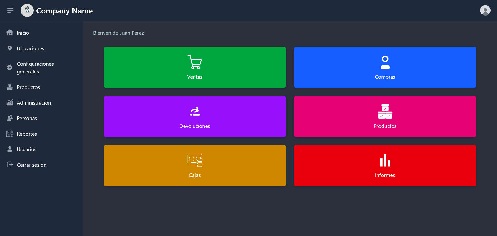
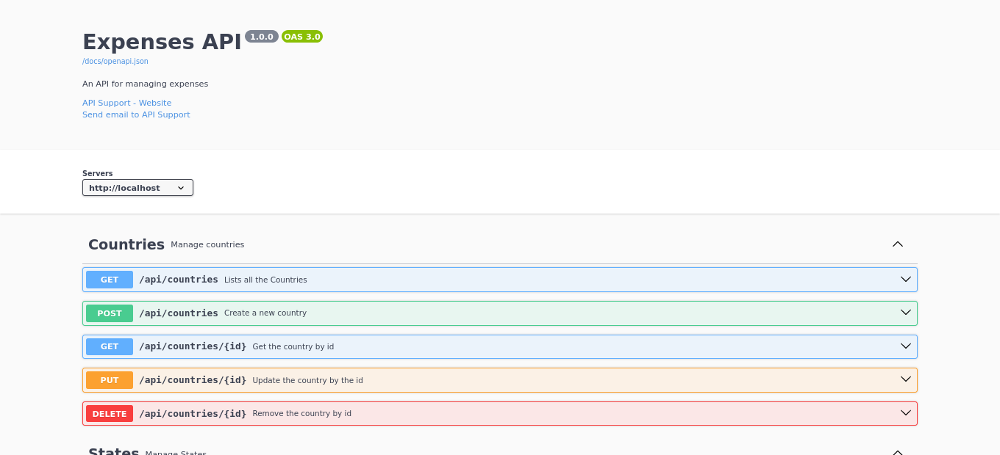

# Contalink

Sistema de gestión financiera y operativa para pymes, desarrollado con Laravel, Inertia y Vite. El proyecto centraliza la administración de ventas, compras, caja, usuarios, clientes/proveedores, productos y reportes, con una API REST segura y un frontend moderno para la operación diaria.

## Descripción general

Contalink está pensado para negocios que necesitan llevar un control claro de sus movimientos financieros y operativos. Incluye gestión de:

- Ventas y compras
- Cajas y movimientos de efectivo
- Clientes, proveedores y personas
- Productos, marcas, categorías y unidades de medida
- Usuarios, roles y permisos
- Tipos de pago, IVA, estados, ciudades y países
- Reportes y consultas rápidas
- Auditoría y control de acceso

## Funcionalidades principales

### 1. Gestión de ventas

- Registro de ventas con detalle por producto
- Búsqueda por número de comprobante
- Consulta individual y listado paginado
- Eliminación con reversión de stock
- Reportes de ventas

### 2. Gestión de compras

- Registro y consulta de compras
- Detalle de productos comprados
- Eliminación con actualización de inventario
- Reportes de compras

### 3. Gestión de caja y cobranzas

- Apertura, cierre, depósito y transferencia de cajas
- Historial de movimientos por caja
- Resúmenes y reportes de cierre
- Validación de montos y operación en tiempo real

### 4. Gestión de personas y clientes

- Registro de clientes, proveedores y personas genéricas
- Filtrado por tipo de persona
- Búsqueda dinámica para formularios y ventas/compras

### 5. Catálogo de productos y referencias

- Productos
- Marcas
- Categorías
- Unidades de medida
- Tipos de IVA
- Tipos de pago
- Países, estados y ciudades

### 6. Seguridad y administración

- Autenticación con Sanctum
- Usuarios con roles y permisos
- Control de acceso por módulo
- Registro de auditoría y trazabilidad de cambios

### 7. API y servicios auxiliares

- Endpoints para ventas, compras, proveedores, cajas, usuarios y permisos
- Búsqueda dinámica y datos en tiempo real
- Soporte para operaciones complejas de detalle y pagos
- Integración con Swagger para documentación de la API

## Stack tecnológico

- PHP 8.3+
- Laravel 13
- PostgreSQL
- Inertia.js
- Vite
- Svelte
- Sanctum
- Spatie Laravel Permission
- Swagger
- DomPDF

## Requisitos

Antes de instalar el proyecto, asegúrate de tener instalado:

- PHP 8.3 o superior
- Composer
- Node.js 20+ y npm
- PostgreSQL 14 o superior
- Git

## Guía de instalación

### 1. Clonar el repositorio

```bash
git clone https://github.com/acristhian1411/Contalink.git
cd Contalink
```

### 2. Instalar dependencias de PHP

```bash
composer install
```

### 3. Instalar dependencias de frontend

```bash
npm install
```

### 4. Configurar el entorno

Copia el archivo de ejemplo:

```bash
cp .env.example .env
```

Edita el archivo `.env` y configura la conexión a PostgreSQL, por ejemplo:

```env
APP_NAME=Contalink
APP_ENV=local
APP_KEY=
APP_DEBUG=true
APP_URL=http://localhost:8000

DB_CONNECTION=pgsql
DB_HOST=127.0.0.1
DB_PORT=5432
DB_DATABASE=contalink
DB_USERNAME=postgres
DB_PASSWORD=postgres
```

Si aún no tienes la base de datos creada:

```bash
createdb contalink
```

### 5. Generar la clave de la aplicación

```bash
php artisan key:generate
```

### 6. Ejecutar migraciones y seeders

```bash
php artisan migrate --seed
```

Esto crea la estructura de la base de datos y carga datos iniciales del sistema.

### 7. Compilar assets del frontend

Para entorno de producción:

```bash
npm run build
```

Para desarrollo local, puedes usar:

```bash
php artisan dev
```

Esto levanta la aplicación y compila los assets con Vite en modo desarrollo.

### 8. Ejecutar la aplicación

Opción tradicional:

```bash
php artisan serve
```

Luego abre en el navegador:

- Frontend: http://localhost:8000
- Swagger: http://localhost:8000/swagger/documentation

## Estructura principal del proyecto

- `app/` - lógica de negocio, modelos, controladores, middleware y utilidades
- `routes/` - definiciones de rutas web y API
- `database/migrations/` - migraciones de base de datos
- `database/seeders/` - sembradores de datos iniciales
- `resources/` - vistas, assets y frontend con Vite/Svelte
- `public/` - archivos estáticos y build
- `tests/` - pruebas automáticas

## Documentación

La API está documentada con Swagger. Puedes acceder a la documentación desde:

```text
http://localhost:8000/swagger/documentation
```

## Capturas




## Notas

- El sistema está orientado a entornos de gestión comercial y financiera de pequeñas y medianas empresas.
- La API está protegida con autenticación y permisos por módulo.
- Para desarrollo local, la combinación recomendada es `php artisan dev` junto con PostgreSQL configurado correctamente.
